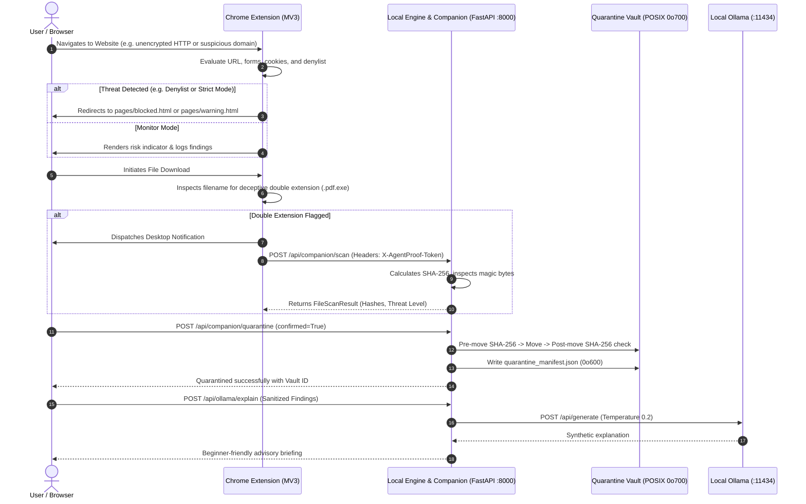

# System Architecture — AgentProof Local Security Suite

## 1. System Overview

AgentProof Local is a local-first personal security suite composed of four synchronized components:

1. **Chrome Security Extension (Manifest V3)**: Monitors browser navigation and downloads, executes DOM and form inspection, checks cookies (zero values stored), detects deceptive double extensions, and redirects to warning/blocked screens based on user-configured policy.
2. **Local Security Engine & API (FastAPI)**: Evaluates deterministic risk scores (0–100), coordinates scans, executes 5-layer AI agent security policy rules, and provides structured reporting.
3. **Local Desktop Companion & Quarantine Vault**: Provides authenticated local host services: calculates cryptographic hashes (SHA-256, SHA-1, MD5), detects magic byte mismatches, executes EICAR test detection, queries local ClamAV, and manages an isolated `0o700` quarantine repository with pre/post hash validation.
4. **Local Ollama AI Integration**: Connects to locally running models (e.g., Gemma 4) on loopback (`http://localhost:11434`) to provide beginner-friendly explanations and summarize privacy policy text. The LLM is strictly decoupled from decision-making; core scans and fail-closed policies operate even when Ollama is offline.

---

## 2. Component Communication & Data Flow



---

## 3. Security Boundaries & Authentication

### Loopback-Only Binding
All backend servers (Streamlit UI, FastAPI companion API, and Vite web dashboard) bind strictly to loopback interfaces (`127.0.0.1` and `localhost`). They never listen on `0.0.0.0` or accept connections from foreign network interfaces.

### Token Authentication
Privileged companion endpoints (`/api/companion/*`) require token authentication via the `X-AgentProof-Token` header or Bearer authorization. Requests lacking the matching token are rejected with HTTP 401 Unauthorized.

### Zero-Knowledge Cookie Policy
The Chrome extension and companion API adhere to strict zero-knowledge principles:
- Cookie values are stripped immediately upon extraction (`chrome.cookies.getAll`).
- Only metadata flags (`name`, `domain`, `path`, `secure`, `httpOnly`, `sameSite`, `session`) are analyzed.
- Cookie names matching authentication patterns (`token`, `session`, `jwt`, `key`) are partially redacted in display views.
- No cookie values are ever stored in databases, written to disk, sent to Ollama, or included in exported reports.

---

## 4. Directory Structure

```text
AgentGuard/
├── PROJECT_AUDIT.md            # Complete defect audit & test execution record
├── SECURITY.md                 # Security policies, boundaries, & permissions
├── ARCHITECTURE.md             # System architecture & component data flows
├── README.md                   # Setup, installation, & user documentation
└── agentproof-local/
    ├── app.py                  # Streamlit desktop companion dashboard (13 sections)
    ├── agentproof/
    │   ├── config.py           # Application configuration & tokens
    │   ├── server.py           # FastAPI backend & companion endpoints
    │   ├── risk_engine.py      # Deterministic 0-100 risk scoring engine
    │   ├── website_scanner.py  # Network transport & credential form inspector
    │   ├── cookie_analyzer.py  # Zero-knowledge cookie security analyzer
    │   ├── permission_analyzer.py # Site origin permission analyzer
    │   ├── file_scanner.py     # Local file scanner & cryptographic hashing
    │   ├── quarantine_manager.py # POSIX 0o700 quarantine vault & manifest
    │   ├── ollama_service.py   # Local Ollama integration & policy summarizer
    │   ├── notification_service.py # Alert dispatcher & cooldown engine
    │   └── policy_engine.py    # Authoritative deterministic AI agent policy
    ├── chrome-extension/
    │   ├── manifest.json       # Manifest V3 extension configuration
    │   ├── background/         # Service worker event listeners (nav & download)
    │   ├── popup/              # Real-time safety evaluation dashboard
    │   ├── options/            # Protection rules & threshold configuration
    │   ├── pages/              # Blocked and warning pages with override controls
    │   ├── scanner/            # Content & background security scanners
    │   ├── risk/               # JS heuristic risk scoring engine
    │   └── tests/              # 22 automated extension unit tests
    ├── frontend/               # 3D animated web UI & documentation portal
    └── tests/                  # 89 automated Python pytest unit & integration tests
```
