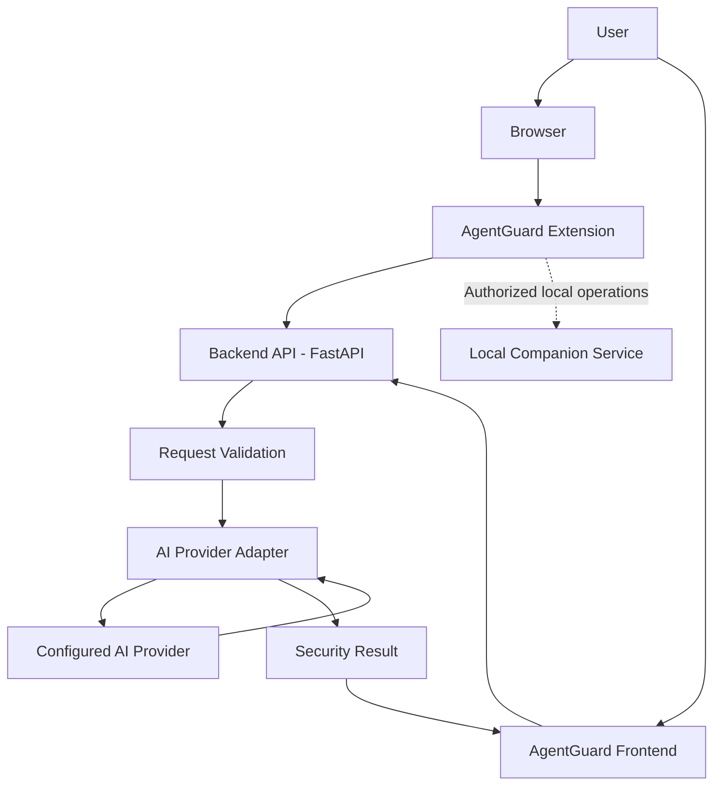

# 🛡️ AgentGuard

<div align="center">

### Your Intelligent Shield Against Malicious Websites

An AI-assisted browser security project designed to help users identify potentially malicious websites, strengthen browsing safety, and manage security-related actions through a browser extension and local companion service.

[🚀 Live Frontend](https://agentguard-zeta.vercel.app) · [⚙️ Backend API](https://agentguard-8hwl.onrender.com) · [💻 Source Code](https://github.com/shreyash-bhosale/AgentGuard)

**Built for Hacktoberfest · AI Security · Browser Protection**

</div>

---

## 📌 Table of Contents

- [Overview](#-overview)
- [Problem Statement](#-problem-statement)
- [Our Solution](#-our-solution)
- [Core Features](#-core-features)
- [Security Architecture](#-security-architecture)
- [System Architecture](#-system-architecture)
- [Technology Stack](#-technology-stack)
- [Project Structure](#-project-structure)
- [Getting Started](#-getting-started)
- [Environment Variables](#-environment-variables)
- [Running Locally](#-running-locally)
- [Testing and Verification](#-testing-and-verification)
- [Deployment](#-deployment)
- [Security Best Practices](#-security-best-practices)
- [Limitations](#-limitations)
- [Future Improvements](#-future-improvements)
- [Contributing](#-contributing)
- [License](#-license)
- [Acknowledgements](#-acknowledgements)

---

## 🔍 Overview

AgentGuard is a browser security project focused on reducing the risks associated with malicious websites, suspicious browsing activity, and unsafe interactions on the web.

The project combines a browser-facing interface, a backend service, and an AI inference integration to support security-related analysis.

AgentGuard is designed around three priorities:

- **Proactive protection:** Help identify potentially dangerous websites before users interact with them.
- **Privacy-conscious processing:** Keep private AI credentials on the backend rather than exposing them in frontend code.
- **Practical security controls:** Combine detection, clear feedback, and security-focused workflows.

The actual protection available depends on the installed extension, configured backend, enabled integrations, and implemented security checks.

## 🎯 Problem Statement

Modern web users regularly encounter phishing pages, deceptive links, malicious redirects, suspicious permission requests, and websites designed to collect sensitive information.

Traditional browser warnings are valuable, but users can still struggle to evaluate unfamiliar websites and understand the risks associated with their actions.

Security tools must also balance effective protection with usability and privacy.

AgentGuard explores how browser-level controls and AI-assisted analysis can help users make safer browsing decisions.

## 💡 Our Solution

AgentGuard brings browser security and AI-assisted analysis into a unified project.

The intended workflow is:

1. A user encounters a website or URL.
2. The browser-facing component gathers the information permitted by its implementation and permissions.
3. Relevant information is sent to the configured analysis service when required.
4. The backend validates the request and invokes the configured AI provider when applicable.
5. The application processes the result and presents security-related feedback.
6. Any protective action is performed only through implemented, permitted browser or companion-service capabilities.

AI output should be treated as an additional security signal rather than definitive proof that a website is safe or malicious.

---

## ✨ Core Features

### 🌐 Browser Security

AgentGuard is intended to support browser security workflows for suspicious websites and browsing activity.

Potential protections depend on the current extension implementation and its granted permissions.

### 🤖 AI-Assisted Analysis

The backend supports a configurable AI-provider architecture intended to make AI-based analysis available without placing provider credentials in browser code.

Documented provider options include:

- `gemma_cloud`
- `gemma_openai`
- `ollama`

Only providers implemented and correctly configured in the current codebase will work.

### 🔐 Backend Credential Protection

Private AI credentials are configured on the server side.

The frontend uses a public API base URL to communicate with the backend and must not receive private provider keys.

### 🧩 Local Companion Service

The project includes a local backend component under `agentproof-local`, with a FastAPI server and a companion API configuration.

Where companion operations are enabled, requests should be authenticated and restricted to authorized local clients.

### ⚙️ Configurable Deployment

The application separates frontend and backend configuration to support independent deployment.

- Frontend: Vercel
- Backend: Render or a compatible deployment environment
- AI inference: A supported and configured provider

### 🧪 Automated Verification

The project includes Python test and live API verification commands to help validate the backend and deployment.

The current test results should be checked before claiming that every test passes.

---

## 🏗️ System Architecture

The following diagram illustrates the intended high-level architecture. The exact request flow depends on the features enabled in the current implementation.



### Architecture Principles

- **Separation of concerns:** Browser UI, backend processing, and AI inference have separate responsibilities.
- **Credential isolation:** AI provider secrets remain on the backend.
- **Request validation:** Backend endpoints should validate incoming data before processing it.
- **Controlled permissions:** Browser and local companion capabilities should use the minimum permissions required.
- **Graceful failure:** AI timeouts or provider errors should not be misrepresented as proof that a website is safe.

---

## 🛡️ Security Architecture

Security is a central design consideration for AgentGuard.

| Security Area | Approach |
|---|---|
| Container privileges | The supplied project notes specify a non-root container user with UID `1001`. Verify this against the deployed container configuration. |
| AI secret protection | `GEMMA_API_KEY` must remain exclusively in backend configuration. |
| Frontend configuration | `VITE_API_BASE_URL` identifies the backend and is not a secret. |
| CORS | Restrict permitted origins to the required frontend domains. |
| Companion authentication | Use a strong, private token for protected local companion operations where supported. |
| Request validation | Validate incoming API data and reject invalid requests. |
| Error handling | Avoid returning credentials, private environment variables, or sensitive implementation details in error messages. |
| Cookie protection | Document and test the actual masking or redaction implementation before making stronger security claims. |

### 🔑 Secret Management

Never commit real API keys or private tokens to Git.

Use your hosting provider's environment-variable or secret-management settings for production credentials.

If a credential has been exposed in a public repository, rotate it. Removing it from the latest commit alone does not remove it from Git history.

### ⚠️ Security Disclaimer

No security tool can guarantee detection of every malicious website. AI-based analysis can produce false positives and false negatives.

AgentGuard should not be described as providing complete browser protection unless the relevant features have been implemented, independently tested, and verified in the deployed extension.

---

## 🧰 Technology Stack

The following technologies are identified by the supplied project configuration and commands.

| Layer | Technology |
|---|---|
| Backend framework | FastAPI |
| Backend language | Python |
| ASGI server | Uvicorn |
| Backend testing | Pytest |
| Frontend | React-based application, as indicated by the supplied development workflow |
| Frontend build tool | Vite, if configured in the current frontend package |
| AI integration | Configurable provider adapters |
| AI provider options | Gemma cloud, OpenAI-compatible provider, Ollama |
| Frontend deployment | Vercel |
| Backend deployment | Render; Cloud Run is a documented alternative |
| Browser integration | Browser extension, subject to the current implementation |

Confirm the frontend framework, AI provider adapters, and deployment configuration against the repository before treating every listed option as an active integration.

---

## 📂 Project Structure

The following is a simplified view of the documented paths. Additional files and directories may exist in the repository.

```text
AgentGuard/
├── agentproof-local/
│   ├── agentproof/
│   │   └── server.py
│   ├── frontend/
│   │   ├── package.json
│   │   └── src/
│   ├── scripts/
│   │   └── verify_live_api.py
│   ├── .venv/
│   └── tests/
├── README.md
└── .gitignore
```

**Note:** This is an illustrative structure based on the supplied commands, not a verified exhaustive repository tree. Keep the README aligned with the actual tracked files and never commit the local `.venv/` directory.

---

## 🚀 Getting Started

### Prerequisites

Install the tools required by the components you intend to run:

- Git
- Python 3.11 or another version supported by the project's dependencies
- Node.js and npm
- A supported AI provider credential, if using a cloud inference provider
- A Chromium-based browser, if testing the browser extension

Check the project's dependency files for exact supported runtime versions.

### 1. Clone the Repository

```bash
git clone https://github.com/shreyash-bhosale/AgentGuard.git
cd AgentGuard
```

If the repository URL or capitalization differs, use the exact URL shown on the project's GitHub page.

### 2. Set Up the Python Environment

```bash
cd agentproof-local

python3 -m venv .venv
source .venv/bin/activate

python -m pip install --upgrade pip
```

Install the dependencies using the method supported by the repository.

For a project with a `requirements.txt` file:

```bash
pip install -r requirements.txt
```

If the project uses `pyproject.toml` or another dependency manager, follow its documented installation instructions instead.

### 3. Configure Environment Variables

Configure the required backend variables before starting the service.

Do not put private AI credentials in frontend files, source code, or public configuration.

### 4. Install Frontend Dependencies

Open another terminal:

```bash
cd agentproof-local/frontend
npm install
```

Start the frontend using the commands described below.

---

## ⚙️ Environment Variables

### Backend Environment

Configure these variables in your backend deployment settings or local environment.

| Variable | Required | Example | Description |
|---|---|---|---|
| `AI_PROVIDER` | For AI inference | `gemma_cloud` | Selects a supported AI adapter. |
| `GEMMA_MODEL` | For the relevant provider | `gemma-4-26b-a4b-it` | Configures the requested model identifier. Confirm provider compatibility. |
| `GEMMA_API_KEY` | For authenticated cloud inference | `<YOUR_PRIVATE_API_KEY>` | Private AI provider credential. |
| `AI_REQUEST_TIMEOUT_SECONDS` | Optional | `30` | Maximum time allowed for AI inference requests. |
| `CORS_ORIGINS` | Deployment-dependent | `<YOUR_FRONTEND_ORIGIN>` | Allowed frontend origins, according to the backend's CORS implementation. |
| `COMPANION_TOKEN` | If companion authentication requires it | `<GENERATED_SECRET_TOKEN>` | Shared secret for supported local companion operations. |
| `PORT` | Host-dependent | Assigned by the platform | Port used by the backend service. |

The documented AI provider values are examples of the intended configuration. Verify that each adapter is implemented and that the configured model is available through the chosen provider.

### Frontend Environment

Create a local frontend environment file if required by the application:

```dotenv
VITE_API_BASE_URL=http://127.0.0.1:8000
```

For production, use the actual deployed backend URL:

```dotenv
VITE_API_BASE_URL=https://agentguard-8hwl.onrender.com
```

### Important Configuration Notes

1. Variables prefixed with `VITE_` may be included in the frontend bundle. Never store secrets in them.
2. Keep the real `GEMMA_API_KEY` in the backend environment only.
3. Replace all example values with the correct values for your deployment.
4. Do not use a hardcoded demonstration companion token in production.
5. Configure CORS using the exact origins that the backend is intended to trust.
6. Restart the relevant development server after changing environment variables.

---

## 💻 Running Locally

### Start the Backend

From the project root:

```bash
cd agentproof-local
source .venv/bin/activate

uvicorn agentproof.server:app \
  --host 127.0.0.1 \
  --port 8000 \
  --reload
```

The backend should now listen at:

`http://127.0.0.1:8000`

If the application exposes an OpenAPI documentation page, you can check:

`http://127.0.0.1:8000/docs`

### Start the Frontend

In a separate terminal:

```bash
cd agentproof-local/frontend
npm run dev
```

Open the local URL printed by Vite in your terminal, commonly:

`http://localhost:5173`

### Stop the Services

Press `Ctrl+C` in each terminal running a development server.

---

## 🧪 Testing and Verification

AgentGuard includes commands for backend tests, live API verification, and frontend build validation.

### Run the Python Test Suite

```bash
cd agentproof-local
source .venv/bin/activate

PYTHONPATH=. .venv/bin/pytest
```

The project notes report **111 tests**. The current repository may have changed, so use the actual test output to confirm the number of collected tests and their results.

### Verify the Live Backend

```bash
cd agentproof-local

BASE_URL="https://agentguard-8hwl.onrender.com" \
  .venv/bin/python scripts/verify_live_api.py
```

This command is intended to run the project's live API verification script against the deployed backend.

It does not, by itself, prove that every security control works under every condition.

### Build the Frontend

```bash
cd agentproof-local/frontend
npm run build
```

Resolve build errors before deploying the frontend.

### Pre-Demo Checklist

- [ ] Frontend loads successfully.
- [ ] Frontend API requests reach the correct backend.
- [ ] Backend starts with the intended environment variables.
- [ ] Automated tests pass.
- [ ] Live API verification completes successfully.
- [ ] Invalid requests are handled appropriately.
- [ ] AI provider failures and timeouts are handled safely.
- [ ] Private API keys are absent from browser bundles.
- [ ] Companion operations require the intended authentication.
- [ ] Browser permissions match the implemented functionality.
- [ ] Cookie masking and redaction are verified with appropriate tests.
- [ ] Production configuration matches the current deployment.

---

## ☁️ Deployment

AgentGuard's documented deployment configuration separates the frontend from the backend.

### Frontend — Vercel

Live frontend:

https://agentguard-zeta.vercel.app

Configure the frontend environment variable:

```dotenv
VITE_API_BASE_URL=https://agentguard-8hwl.onrender.com
```

After changing production environment variables, rebuild or redeploy the frontend as required by Vercel.

### Backend — Render

Live backend:

https://agentguard-8hwl.onrender.com

Configure the backend environment variables in the Render dashboard.

The application must bind to the port assigned by the hosting platform when deployed. Do not assume that a development port such as `8000` is always the production port.

### Alternative — Google Cloud Run

The supplied deployment notes also describe Cloud Run as an alternative backend host.

For Cloud Run:

- Configure the required environment variables and secrets.
- Ensure the container listens on the port supplied by the platform.
- Run the container using a non-root user where supported by the deployment configuration.
- Configure the correct frontend origins.
- Verify the deployed service using the project's test and live API verification commands.

Do not claim a Cloud Run deployment is active unless one has actually been deployed.

---

## 🔒 Security Best Practices

AgentGuard should follow these security practices as its implementation evolves.

### Least Privilege

Grant the browser extension only the permissions required for its documented features.

Avoid broad access to every website or unrestricted control over browser data unless strictly necessary and clearly disclosed to the user.

### Safe Browser Actions

Browser protection should be implemented through documented browser extension APIs and explicitly authorized operations.

Security actions should be predictable, auditable, and reversible where appropriate. Avoid silently deleting user data or treating an AI classification as sufficient justification for destructive actions.

### Local Companion Protection

A local companion service should:

- Bind to loopback interfaces when remote access is unnecessary.
- Authenticate privileged requests.
- Validate request origins and input data as appropriate.
- Avoid exposing privileged operations to arbitrary websites.
- Protect tokens against disclosure.
- Reject unauthorized requests.

A shared token alone is not a complete security boundary. Browser-origin checks, network binding, authentication, and request validation must work together.

### AI Security

- Keep cloud provider keys on the backend.
- Apply request timeouts and sensible resource limits.
- Validate model outputs before acting on them.
- Treat webpage content as untrusted input.
- Avoid sending unnecessary private browsing data to external AI providers.
- Never let webpage instructions override the application's security policies.

### Cookie and Session Privacy

Any cookie masking or redaction feature should be tested against the actual data paths where sensitive values could appear.

Do not log authentication cookies, session tokens, authorization headers, or private credentials.

---

## ⚠️ Limitations

AgentGuard's effectiveness depends on the implementation, permissions, configuration, and quality of the security signals available.

Potential limitations include:

- AI analysis may misclassify a website.
- New or obfuscated threats may evade detection.
- Cloud AI features depend on network connectivity and provider availability.
- Rate limits, API failures, and timeouts can affect inference.
- Browser capabilities depend on the extension platform and granted permissions.
- A backend deployment does not automatically mean that every local companion or extension feature is available.
- Security controls require independent testing; configuration alone is not proof of effectiveness.

AgentGuard should complement, not replace, browser security features, operating-system updates, and safe browsing practices.

---

## 🛣️ Future Improvements

Potential improvements for future development include:

- [ ] Expand malicious URL and phishing detection.
- [ ] Add reproducible security evaluation datasets and benchmarks.
- [ ] Improve explanations for suspicious website classifications.
- [ ] Add more robust false-positive and false-negative reporting.
- [ ] Improve privacy controls for AI-assisted analysis.
- [ ] Expand automated integration and browser-extension tests.
- [ ] Improve resilience when the backend or AI provider is unavailable.
- [ ] Strengthen local companion authentication and authorization.
- [ ] Add clearer security event reporting and diagnostics.

These are proposed improvements, not claims that the features are already implemented.

---

## 🤝 Contributing

Contributions, bug reports, documentation improvements, and security-focused suggestions are welcome.

### How to Contribute

1. Fork the repository.
2. Create a feature branch.
3. Make a focused change.
4. Run the relevant tests.
5. Check that no credentials or personal data have been committed.
6. Submit a pull request describing the change and its verification.

Example:

```bash
git checkout -b feat/improve-security-analysis

# Make your changes.

git add .
git commit -m "Improve security analysis"
git push origin feat/improve-security-analysis
```

Open a pull request from your branch and explain:

- What changed.
- Why the change is useful.
- How it was tested.
- Any security or privacy implications.

### Reporting Security Issues

Avoid publishing exploitable vulnerabilities, private tokens, or sensitive user data in public issues.

Use an appropriate private reporting channel if one is available for the repository.

---

## 📄 License

Add the license that applies to this repository.

If the project does not yet contain a `LICENSE` file, select an appropriate license before claiming that the project is open source. Until then, do not imply that reuse or redistribution is automatically permitted.

---

## 🙌 Acknowledgements

AgentGuard is developed as a security-focused project exploring browser protection, AI-assisted analysis, and practical application security.

Thanks to the open-source communities and developers whose tools and documentation make experimentation and collaborative development possible.

---

<div align="center">

## 🛡️ AgentGuard

**Building safer browsing experiences through practical security engineering.**

[Live Frontend](https://agentguard-zeta.vercel.app) · [Backend API](https://agentguard-8hwl.onrender.com) · [GitHub Repository](https://github.com/shreyash-bhosale/AgentGuard)

*Security is a continuous process, not a one-time feature.*

</div>
