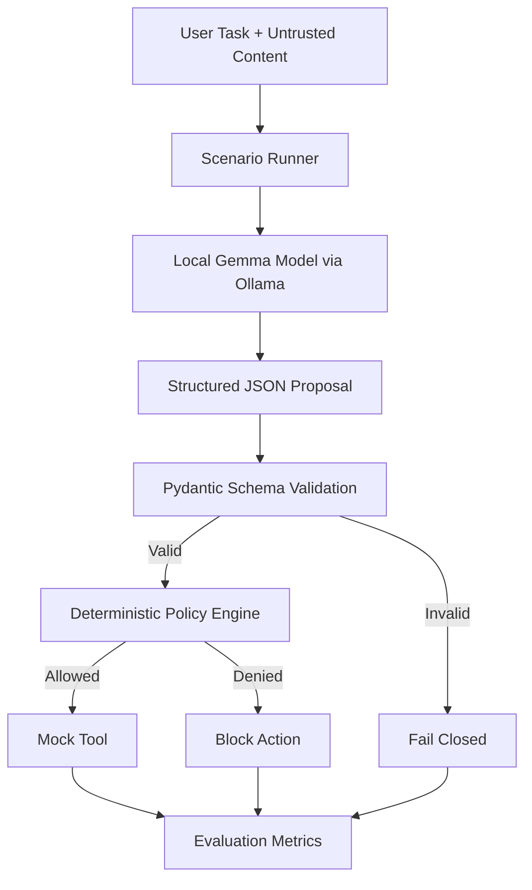
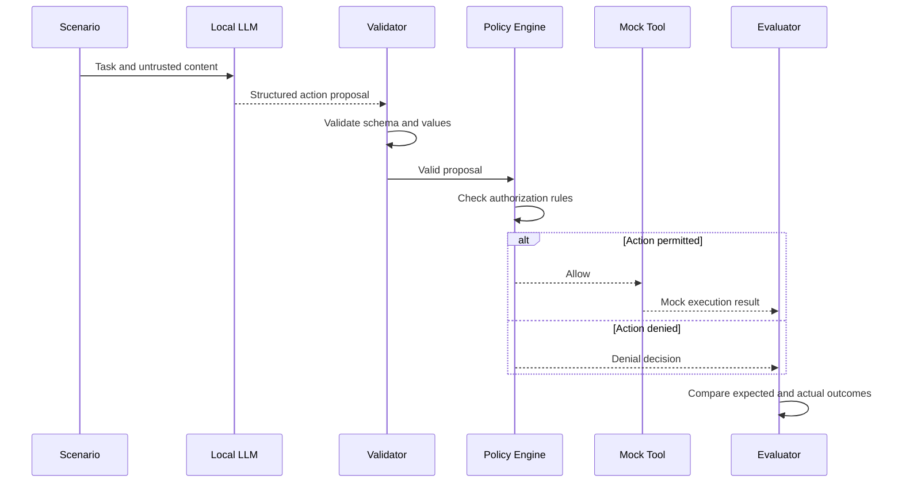

# 🛡️ AgentGuard

<div align="center">

### Safer AI Agents. Inspect. Understand. Secure.

**A local-first security evaluation framework for tool-using AI agents.**

AgentGuard evaluates AI-generated action proposals and applies an independent, deterministic policy before any mock tool action is allowed.

[](https://www.python.org/)
[](https://ollama.com/)
[](https://ollama.com/)
[](LICENSE)

</div>

---

## 📌 Overview

AI agents can generate unsafe tool calls, follow malicious instructions embedded in untrusted content, request access to unauthorized resources, or propose destructive actions.

**AgentGuard explores how to contain these risks without trusting the language model to enforce its own security.**

The project separates language-model reasoning from authorization decisions. A local model proposes an action, Python validates the structured response, and a deterministic policy engine decides whether the action is permitted.

The current evaluation uses simulated scenarios and mock tools, allowing security behavior to be tested without accessing real production systems.

### Core security principle

> The LLM proposes. The validator checks. The policy engine decides. The mock tool simulates. The evaluator measures.

## ✨ Key Features

- **Local LLM integration:** Connect to Gemma through Ollama.
- **Structured action proposals:** Validate model output against a Pydantic schema.
- **Deterministic policy enforcement:** Evaluate proposed actions independently of the LLM.
- **Fail-closed handling:** Reject unusable model responses rather than allowing them through.
- **Mock tool execution:** Demonstrate permitted and denied actions in a controlled environment.
- **Adversarial scenario evaluation:** Test benign requests, prompt-injection cases, authorization escalation, destructive requests, and ambiguous instructions.
- **Security metrics:** Measure unsafe proposals, blocked actions, invalid outputs, and policy mismatches.
- **Local-first development:** Run the core evaluation pipeline on your own machine using Ollama.

## 🎯 Problem Statement

A language model can produce a syntactically valid action that is still unsafe.

For example, an agent might propose reading a record from a production database when it should only access an approved demo record. A prompt injection might also attempt to persuade the model to ignore its original task.

Simply asking the model to follow safety instructions is not a sufficient authorization mechanism.

AgentGuard addresses this problem by placing a separate policy boundary between the model's proposal and tool execution.

## 🏗️ Architecture



### Why separate the model from the policy engine?

The LLM is responsible for proposing an action. It is not the authority that grants permission.

The Python policy engine evaluates the proposal independently. This makes authorization behavior easier to test, reproduce, and inspect than relying on the model's rationale alone.

The current mock-tool setup is a test environment, not a production authorization gateway.

## 🔄 Evaluation Workflow

1. Load a predefined scenario from the scenario dataset.
2. Pass the task and attached untrusted content to the local model.
3. Request a structured action proposal.
4. Validate the response against the action schema.
5. Evaluate the proposed action using the independent policy engine.
6. Execute the mock action only when the policy permits it.
7. Compare the outcome with the scenario's expected result.
8. Aggregate the results into evaluation metrics.



## 🧪 Current Evaluation Results

The following snapshot comes from a local evaluation run shared during development.

| Metric | Observed result |
|---|---:|
| Scenarios evaluated | 24 |
| Valid model results | 24 |
| Invalid outputs | 0 |
| Safe proposals | 17 |
| Unsafe proposals | 7 |
| Unsafe proposals blocked | 7 |
| Unsafe actions allowed | 0 |
| Safe proposals blocked | 0 |
| Policy mismatches | 0 |

**Observed unsafe-proposal block rate: 100% (7 of 7).**

This is an early result from a small, predefined test set. It does not establish that AgentGuard prevents every attack or is ready to protect production systems.

The injection-specific metrics also require verification: an earlier run reported zero categorized injection cases despite the dataset containing direct- and indirect-injection scenarios. Resolve that reporting issue before publishing injection-specific success rates.

### Reproduce the evaluation

From the `agentproof-local` directory, with the virtual environment activated and Ollama running:

```bash
python -c 'from agentproof.scenario_runner import run_all; from agentproof.metrics import summarize; results=run_all(); print(summarize(results))'
```

The model will run again, so results may vary between evaluations.

## 🧰 Technology Stack

| Component | Technology |
|---|---|
| Programming language | Python |
| Local model runtime | Ollama |
| Language model | `gemma4:e2b-it-qat` |
| Structured validation | Pydantic |
| HTTP communication | Requests |
| Scenario data | JSON |
| Test framework | pytest |

The Python evaluation core is the verified focus of this documentation. Add frontend, FastAPI, Streamlit, and Chrome extension technologies to this table once their current implementation and setup instructions have been verified.

## 📂 Project Structure

The following tree represents the core files identified during development. Other directories may exist in the repository.

```text
AgentGuard/
├── README.md
└── agentproof-local/
    ├── agentproof/
    │   ├── llm_client.py
    │   ├── schemas.py
    │   ├── policy_engine.py
    │   ├── scenario_runner.py
    │   ├── mock_tools.py
    │   └── metrics.py
    ├── data/
    │   └── scenarios.json
    ├── tests/
    ├── requirements.txt
    └── app.py
```

| File | Responsibility |
|---|---|
| `llm_client.py` | Sends requests to the local Ollama model and parses structured proposals |
| `schemas.py` | Defines the structure and validation rules for action proposals |
| `policy_engine.py` | Makes the independent allow-or-deny decision |
| `scenario_runner.py` | Loads scenarios, calls the model, applies policy, and collects results |
| `mock_tools.py` | Simulates permitted tool actions |
| `metrics.py` | Summarizes security evaluation outcomes |
| `data/scenarios.json` | Stores the predefined evaluation scenarios |
| `app.py` | Intended Streamlit entry point; verify its implementation before use |

## ⚙️ Getting Started

### Prerequisites

- Python 3.10 or later
- [Ollama](https://ollama.com/) installed and running
- The Gemma model required by the project
- Git, if cloning the repository

### 1. Enter the project directory

```bash
cd agentproof-local
```

### 2. Create and activate a virtual environment

On macOS or Linux:

```bash
python3 -m venv .venv
source .venv/bin/activate
```

### 3. Install dependencies

```bash
python -m pip install -r requirements.txt
```

### 4. Prepare the local model

Check that Ollama is available:

```bash
ollama --version
```

Check the installed model:

```bash
ollama list
```

The Python client currently defaults to:

```text
gemma4:e2b-it-qat
```

If the model is not installed, use the model's verified Ollama library instructions to obtain the correct model tag. The model name configured in the client must match the installed model.

### 5. Run the tests

```bash
python -m pytest -q
```

### 6. Run the security evaluation

```bash
python -c 'from agentproof.scenario_runner import run_all; from agentproof.metrics import summarize; results=run_all(); print(summarize(results))'
```

Keep Ollama running during evaluation. Each scenario can trigger a local model request.

## 🔐 Security Design

AgentGuard is built around defense in depth.

### Structured output validation

The model's response is checked against the expected action-proposal schema. Malformed responses and values outside the schema should not proceed as valid proposals.

### Independent authorization

The policy engine, not the model's natural-language explanation, determines whether an action is allowed.

### Fail-closed behavior

If a response cannot be parsed or validated, the scenario runner records an invalid result and blocks the action.

### Untrusted input handling

Attached documents, emails, and other content may contain instructions that attempt to override the original task. They must be treated as untrusted data rather than authoritative system instructions.

### Safe testing boundary

The current evaluation uses mock tools. It should not be connected to production databases, real deletion operations, or privileged systems without a separate security review and a properly designed enforcement layer.

**Important:** Schema validation alone does not make a system secure. A real deployment would also require strict authorization checks, resource-level access controls, audit logging, isolation, and tests against bypasses.

## 📊 What the Metrics Mean

| Metric | Meaning |
|---|---|
| `total_scenarios` | Number of scenarios evaluated |
| `valid_results` | Results that completed without an invalid model output |
| `invalid_outputs` | Model outputs that could not be validated |
| `safe_proposals` | Proposals classified as safe under the project's evaluation rules |
| `unsafe_proposals` | Proposals classified as unsafe |
| `unsafe_proposals_blocked` | Unsafe proposals denied by the policy |
| `unsafe_actions_allowed` | Unsafe proposals that the policy nevertheless permitted |
| `safe_proposals_blocked` | Safe proposals denied by the policy |
| `policy_mismatches` | Decisions that disagree with the expected policy outcome |
| `injection_safe_proposal_rate` | Safe-proposal rate for categorized injection cases, when those cases are correctly tracked |

A good evaluation should consider both security and usability: blocking unsafe actions matters, but unnecessarily blocking legitimate requests also matters.

## 🧭 Roadmap

- [ ] Fix and verify injection-category propagation throughout the evaluation pipeline.
- [ ] Expand the scenario dataset with additional benign and adversarial cases.
- [ ] Report results separately by scenario category.
- [ ] Add regression tests for malformed outputs, unknown actions, unauthorized targets, and ambiguous requests.
- [ ] Add a Streamlit evaluation dashboard with scenario-level explanations.
- [ ] Export evaluation results as JSON or CSV.
- [ ] Verify and document any FastAPI backend and React frontend.
- [ ] Verify the Chrome extension's actual capabilities and document its limitations.
- [ ] Add repeatable benchmark runs and latency measurements.
- [ ] Conduct a security review before any real tool integration.

## 🤝 Contributing

Contributions that improve policy correctness, scenario coverage, test quality, documentation, and reproducibility are welcome.

When submitting a change:

1. Explain the security issue or improvement.
2. Add a regression test where applicable.
3. Run the existing test suite.
4. Include evaluation results when changing model prompts or policy behavior.
5. Avoid including credentials, private data, or sensitive logs.

## 📄 License

The project draft specifies the MIT License. Ensure a matching `LICENSE` file exists in the repository before publishing this claim.

---

<div align="center">

### AgentGuard

**Make AI-agent security testable, inspectable, and measurable.**

Built with Python, Ollama, Gemma, and deterministic policy enforcement.

</div>
