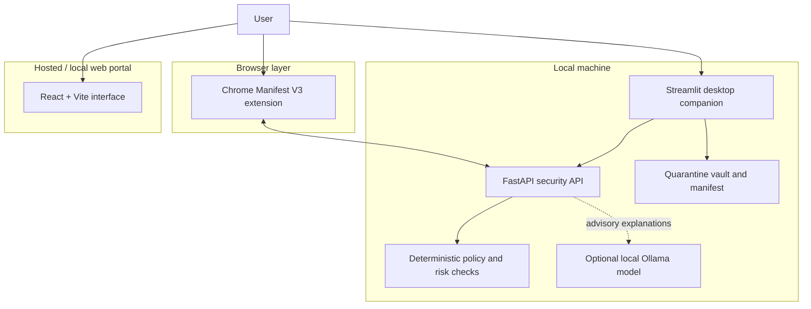

 <div align="center">


# 🛡️ AgentGuard

### Local-first security for browsing, files, and AI-agent actions.

AgentGuard combines a Manifest V3 browser extension, a local FastAPI security engine, a Streamlit desktop companion with a quarantine workflow, and policy-based evaluation of AI-agent proposals.

[](https://frontend-lake-delta-0bodi7q6wt.vercel.app/)
[](https://github.com/shreyash-bhosale/AgentGuard)
[](LICENSE)

**Design principle:** AI may explain and advise; deterministic policy code remains responsible for enforcement.

</div>

---

## 🚀 At a glance

| Component | Local address / path | Purpose |
|---|---|---|
| Web portal | [127.0.0.1:5173](http://127.0.0.1:5173) | React + Vite interface and testing workbenches |
| Local security API | [127.0.0.1:8000/docs](http://127.0.0.1:8000/docs) | FastAPI endpoints, risk analysis, and scenario fixtures |
| Desktop companion | [127.0.0.1:8501](http://127.0.0.1:8501) | Streamlit security utilities and quarantine workflow |
| Chrome extension | `agentproof-local/chrome-extension` | Browser-side checks using Manifest V3 |
| Hosted showcase | [Open live demo](https://frontend-lake-delta-0bodi7q6wt.vercel.app/) | Hosted product showcase |

> **Note:** The hosted showcase is separate from your local security engine. Local API, desktop, extension, and Ollama features require the relevant components to be installed and running locally.

## 📸 Product tour

Screenshots below use paths supplied in the project documentation. Confirm that each asset exists in the repository and keep filenames in sync with the actual files.

### Landing page

<p align="center">

</p>

### Demo walkthrough

<p align="center">

</p>

### Security testing workbench

<p align="center">

</p>

### Policy simulator

<p align="center">

</p>

### Chrome extension

<p align="center">

</p>

### Desktop quarantine vault

<p align="center">

</p>

### Evaluation dashboard

<p align="center">

</p>

## ✨ Core capabilities

### 🌐 Browser protection

The Manifest V3 extension evaluates browser and website signals, including:

- Plain HTTP and insecure login-page warnings.
- Hostname indicators such as IP-literal hosts and Punycode (`xn--`) domains.
- Downloads with potentially deceptive double extensions.
- Cookie security attributes, with a privacy boundary intended to avoid collecting raw cookie values.
- Configurable protection modes, from monitoring and warnings to blocking.

These checks are security signals, not a guarantee that every malicious website will be detected. Keep Chrome and your operating system updated.

### 🧰 Local security API

The FastAPI service is designed to run on the loopback interface (`127.0.0.1`) and provide a local boundary for security checks.

- Deterministic risk scoring on a 0–100 scale.
- Scenario runners and controlled test fixtures.
- Token-based request authentication using `X-AgentProof-Token`.
- Fail-closed handling for rejected or invalid AI-agent proposals, where implemented by the policy path.

### 🗃️ Desktop companion and quarantine vault

The Streamlit companion provides local security utilities and a quarantine workflow.

- File-type inspection using magic bytes / signatures.
- Cryptographic hashes, including SHA-256.
- Restrictive POSIX directory permissions (`0o700`) on supported systems.
- A quarantine manifest and restore / purge workflow.

Quarantine is not a substitute for antivirus or forensic tools. Hashes can help detect changes but do not prove a file is safe. Test these workflows with disposable files first.

### 🤖 Local AI assistance

AgentGuard can integrate with a locally running [Ollama](https://ollama.com) model for advisory explanations and privacy summaries.

- Model output is treated as advisory, not as authorization.
- Policy checks should validate action names, targets, and constraints before a tool action runs.
- Model unavailability or invalid output should not silently grant permission.

The exact model and available explanations depend on your local Ollama configuration. AI assistance is optional for workflows that do not require it.

## 🏗️ Architecture



The web portal and local services have different responsibilities. Configure the local API, desktop companion, extension, and local model separately.

## 🔐 Security principles

| Principle | Intended behavior |
|---|---|
| **Deterministic enforcement** | Policy code—not free-form model text—decides whether an action is allowed. |
| **Fail closed** | Invalid output or unavailable dependencies should not silently grant permission. |
| **Loopback binding** | The documented local setup binds the API to `127.0.0.1`. |
| **Sensitive-data minimization** | Cookie values, passwords, and tokens should not be copied into logs, reports, or model prompts. |
| **Auditable quarantine** | File hashes and a manifest support integrity checks and traceability. |
| **Least privilege** | Restrictive POSIX permissions are used for the quarantine directory where supported. |

### Security scope and limitations

- Heuristic scores are indicators, not proof that a website or file is malicious or safe.
- An extension cannot guarantee that it will close every malicious page or undo every permission or cookie decision.
- Keep the local API bound to loopback unless a separately reviewed design requires otherwise.
- Never expose the local API publicly or commit tokens, secrets, or private scan results.
- Review the extension permissions and test quarantine / deletion behavior in a controlled environment.

## 🧪 Automated tests

The supplied test summary reports **111 passing tests**:

| Suite | Reported result |
|---|---:|
| Python security engine and companion | 89 passed |
| Chrome extension unit tests | 22 passed |
| **Total** | **111 passed** |

The supplied log reports the Python suite completing in 1.78 seconds and the extension suite in 49 ms, on macOS with Python 3.13 and Node.js v26.4.0. These are reported results from the provided documentation; rerun tests on the current checkout before publishing them as current status.

Run the Python tests:

```bash
cd agentproof-local
source .venv/bin/activate
PYTHONPATH=. pytest tests/ -v
```

Run the extension tests using the script defined in the extension's `package.json`. If the configured script is named `test`, the command is:

```bash
cd chrome-extension
npm test
```

If `npm test` is not defined, use the script that is actually present in `package.json`.

## ⚡ Quickstart

### Prerequisites

- macOS or Linux
- Python 3.10+ (the supplied test log reports Python 3.13)
- Node.js and npm for the web portal / extension tooling
- Google Chrome to load the extension
- [Ollama](https://ollama.com), optional for local model-assisted explanations

### 1. Clone the repository

```bash
git clone https://github.com/shreyash-bhosale/AgentGuard.git
cd AgentGuard
```

### 2. Create the Python environment

```bash
cd agentproof-local
python3 -m venv .venv
source .venv/bin/activate
python -m pip install --upgrade pip
pip install -r requirements.txt
```

### 3. Start the local API

```bash
uvicorn agentproof.server:app --host 127.0.0.1 --port 8000
```

Open the interactive API documentation at [http://127.0.0.1:8000/docs](http://127.0.0.1:8000/docs). The supplied documentation lists `/api/health` as a health route; verify it exists in the current version before relying on it.

### 4. Start the desktop companion

In a new terminal:

```bash
cd AgentGuard/agentproof-local
source .venv/bin/activate
streamlit run app.py --server.port 8501
```

Open [http://127.0.0.1:8501](http://127.0.0.1:8501).

### 5. Start the web portal

In another terminal:

```bash
cd AgentGuard/agentproof-local/frontend
npm install
npm run dev -- --port 5173
```

Open [http://127.0.0.1:5173](http://127.0.0.1:5173).

> **Path note:** These commands assume the repository root is named `AgentGuard` and contains `agentproof-local`. Adjust `cd` paths if your checkout differs.

### 6. Load the Chrome extension

1. Open `chrome://extensions` in Chrome.
2. Enable **Developer mode**.
3. Click **Load unpacked**.
4. Select `AgentGuard/agentproof-local/chrome-extension`.
5. Review requested permissions before using the extension in your everyday browser profile.

The supplied documentation also references a packaged extension at `agentproof-local/frontend/public/agentguard-chrome-extension.zip`. Confirm the archive exists and is current before relying on it.

## ⚙️ Configuration and secrets

Configuration may differ between branches or local checkouts. Find environment examples and settings files before starting:

```bash
find . -maxdepth 3 \( -name ".env.example" -o -name "example.env" -o -name "config.py" \) -print
```

- Keep private tokens and credentials in environment variables or an untracked `.env` file.
- Never commit `.env` files, API keys, access tokens, or sensitive scan results.
- If `X-AgentProof-Token` authentication is enabled, use the token expected by the local API configuration; do not post it in public issues.
- Configure the Ollama endpoint and model name to match your local installation.

## 🗂️ Repository layout

The supplied documentation describes the following main areas. Confirm the exact names against your checkout:

```text
AgentGuard/
├── agentproof-local/
│   ├── agentproof/          # Local security engine and agent-evaluation code
│   ├── chrome-extension/    # Manifest V3 browser extension
│   ├── frontend/            # React + Vite web portal
│   ├── tests/               # Python tests
│   ├── docs/assets/         # Screenshots and demo visuals
│   ├── app.py               # Streamlit desktop companion
│   └── requirements.txt     # Python dependencies
└── README.md
```

## ✅ Pre-demo checklist

- [ ] Python dependencies install successfully from a clean environment.
- [ ] API starts on `127.0.0.1:8000` and its health route responds.
- [ ] Desktop companion launches and its main workflows work.
- [ ] Web portal starts and builds without console errors.
- [ ] Extension loads without manifest errors and requests only documented permissions.
- [ ] Cookie checks do not log or display raw cookie values.
- [ ] Invalid model output is rejected safely.
- [ ] Prohibited actions are denied by policy tests.
- [ ] Quarantine, restore, and purge are tested with disposable sample files.
- [ ] Python and extension tests are rerun and README test counts are updated.

## 🛣️ Roadmap

- [ ] Publish reproducible benchmark reports with scenario definitions.
- [ ] Improve risk-score explanations without allowing them to override enforcement.
- [ ] Expand controlled fixtures for browser and file-security edge cases.
- [ ] Add a clean-install smoke test for all local components.
- [ ] Document a threat model covering what the extension and local services can and cannot protect against.

## 🤝 Contributing

Issues and pull requests are welcome. When reporting a security issue, do not publish credentials, personal information, live exploit links, or sensitive files. Include sanitized reproduction steps, expected behavior, observed behavior, and relevant non-sensitive logs.

## 📜 License

The supplied project documentation identifies the project as MIT-licensed. See [`LICENSE`](LICENSE) and confirm that the license file is present before release.

---

<div align="center">

**AgentGuard — local-first tools, explicit policies, auditable decisions.**

[Live demo](https://frontend-lake-delta-0bodi7q6wt.vercel.app/) · [GitHub repository](https://github.com/shreyash-bhosale/AgentGuard)

</div>
