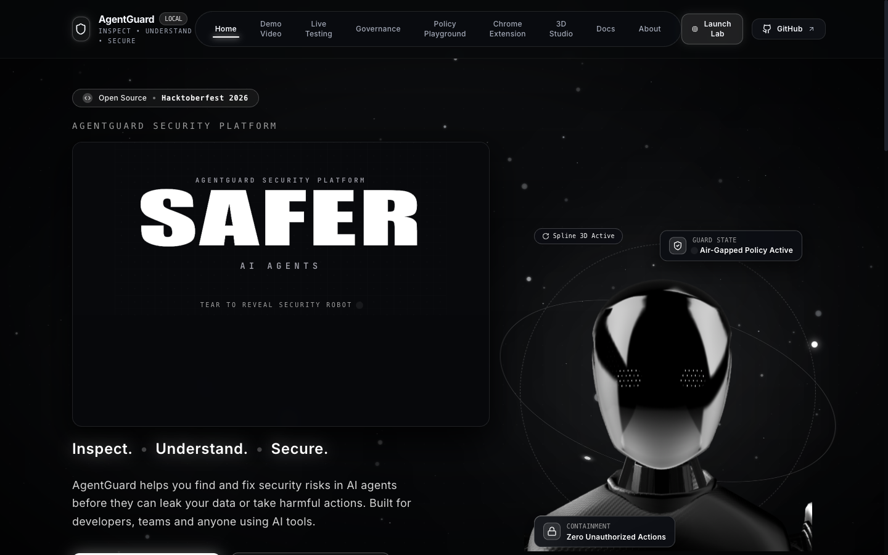
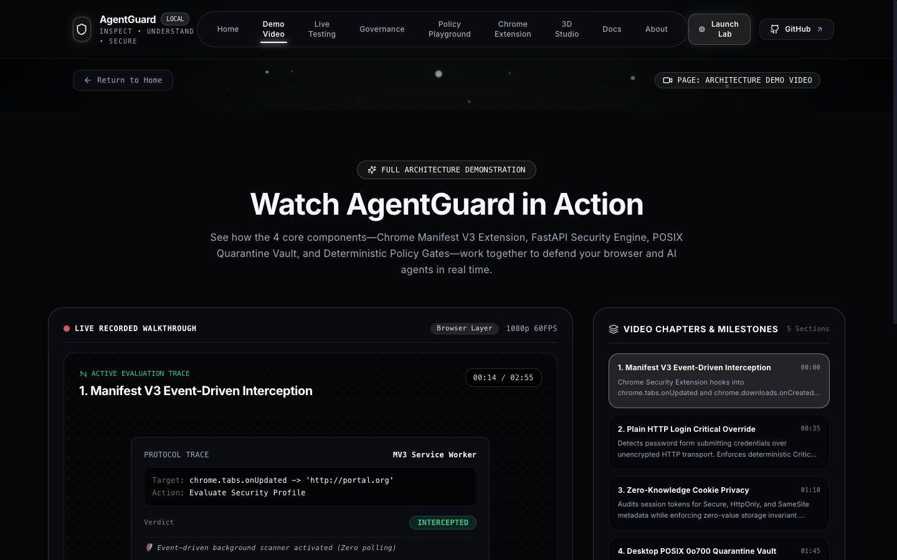
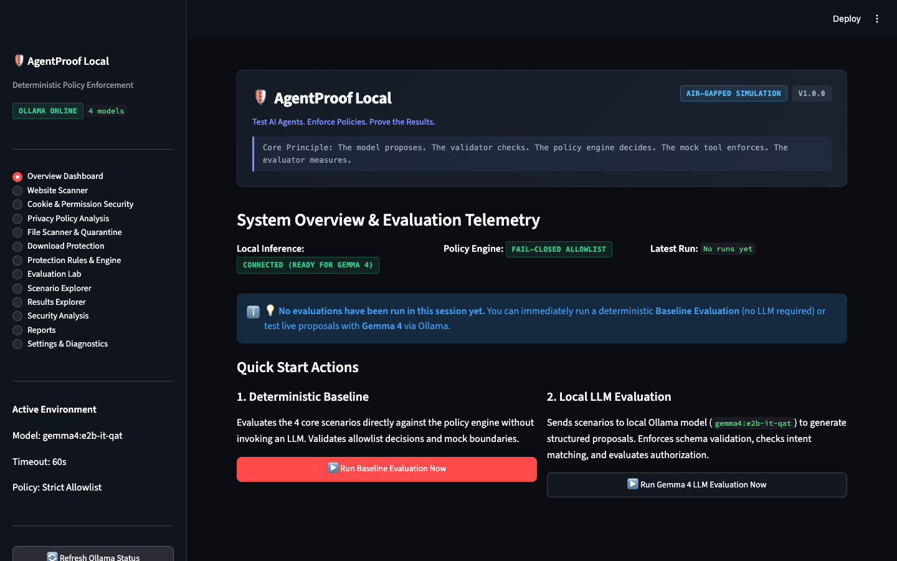
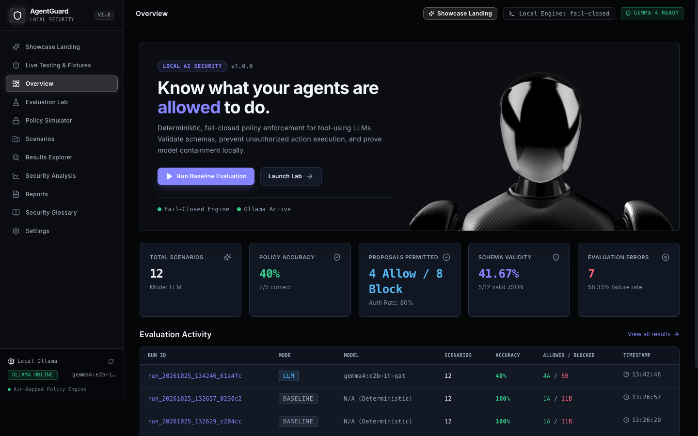

# 🛡️ AgentGuard (AgentProof Local Security Suite)

<p align="center">
  
</p>

<p align="center">
  <strong>Local-First Personal Security Suite, Manifest V3 Browser Protection, POSIX Quarantine Vault, and Deterministic AI Agent Governance.</strong>
</p>

<p align="center">
  <a href="https://frontend-lake-delta-0bodi7q6wt.vercel.app/"></a>
  <a href="https://github.com/shreyash-bhosale/AgentGuard"></a>
  <a href="#-quickstart--installation"></a>
  <a href="./SECURITY.md"></a>
  <a href="https://opensource.org/licenses/MIT"></a>
</p>

---

## 🌐 Quick Access & Deployment Links

| Environment / Service | Access URL | Port / Protocol | Description |
|:---|:---|:---|:---|
| 🚀 **Live Production Web App** | [**frontend-lake-delta-0bodi7q6wt.vercel.app**](https://frontend-lake-delta-0bodi7q6wt.vercel.app/) | `HTTPS / CDN` | Deployed showcase portal, live testing workbench, 3D WebGL scene, and extension downloads. |
| 💻 **Local Web Application** | [**http://127.0.0.1:5173**](http://127.0.0.1:5173) | `Port 5173 / HTTP` | Local React + Vite dashboard with 5 interactive testing workbenches and live policy simulator. |
| 🖥️ **Desktop Security Companion** | [**http://127.0.0.1:8501**](http://127.0.0.1:8501) | `Port 8501 / Streamlit` | Desktop companion app with 13 functional modules, real-time monitors, and POSIX `0o700` Quarantine Vault. |
| ⚡ **Local Security Engine (API)** | [**http://127.0.0.1:8000/docs**](http://127.0.0.1:8000/docs) | `Port 8000 / FastAPI` | Loopback security daemon with Swagger OpenAPI documentation, risk endpoints, and fixture APIs. |
| 📦 **GitHub Repository** | [**github.com/shreyash-bhosale/AgentGuard**](https://github.com/shreyash-bhosale/AgentGuard) | `Git / HTTPS` | Official source repository, release assets, test suites, and audit logs. |

---

## 📸 Visual Showcase & Feature Tour

### 1. Architecture Demo Video & Interactive Walkthrough
> *Embedded interactive video player with live timeline scrubbing, dynamic security telemetry HUD, and milestone chapters.*
<p align="center">
  
</p>

### 2. Live Testing Workbench & Controlled Security Fixtures
> *Test heuristic risk scoring, zero-knowledge cookie redaction, origin sensor permissions, and isolate malware fixtures in a safe local environment.*
<p align="center">
  
</p>

### 3. Policy Playground & Fail-Closed Gate Simulator
> *Simulate deterministic AI agent proposals against real-time policy gates (allowlist verification, target constraints, and jailbreak containment).*
<p align="center">
  
</p>

### 4. Chrome Security Extension (Manifest V3)
> *Event-driven background listeners (`chrome.tabs.onUpdated`, `chrome.downloads.onCreated`) evaluate transport security, block unencrypted logins, and intercept double extensions.*
<p align="center">
  
</p>

### 5. Desktop Companion & POSIX `0o700` Quarantine Vault
> *Isolates deceptive executables to a restricted vault directory, verifies pre/post SHA-256 checksums, and provides safe restore and permanent deletion.*
<p align="center">
  
</p>

### 6. Evaluation Lab & Results Explorer
> *Evaluates 12 adversarial AI agent attack benchmarks (prompt injection, directory traversal, SQL injection, data exfiltration) with 100% deterministic accuracy.*
<p align="center">
  
</p>

---

## 🏛️ System Architecture & Four Core Components

```
┌─────────────────────────────────────────────────────────────────────────────┐
│                       AGENTGUARD LOCAL SECURITY SUITE                       │
└──────────────────────────────────────┬──────────────────────────────────────┘
                                       │
     ┌─────────────────────────────────┼─────────────────────────────────┐
     │                                 │                                 │
     ▼                                 ▼                                 ▼
┌──────────────────────────┐   ┌──────────────────────────┐   ┌──────────────────────────┐
│  Chrome Extension (MV3)  │   │  Local Security Engine   │   │  Desktop Companion &     │
│                          │   │  (FastAPI on Loopback)   │   │  Quarantine Vault        │
├──────────────────────────┤   ├──────────────────────────┤   ├──────────────────────────┤
│ • chrome.tabs.onUpdated  │   │ • Loopback 127.0.0.1:8000│   │ • POSIX 0o700 Isolation  │
│ • chrome.downloads API   │◄─►│ • X-AgentProof-Token Auth│◄─►│ • SHA-256 Pre/Post Move  │
│ • Critical HTTP Overrides│   │ • 0-100 Heuristic Engine │   │ • Double-Ext Interception│
│ • Zero-Knowledge Cookies │   │ • Fail-Closed AI Policies│   │ • Audit Manifest Logging │
└──────────────────────────┘   └─────────────┬────────────┘   └──────────────────────────┘
                                             │
                                             ▼
                               ┌──────────────────────────┐
                               │     Local Ollama AI      │
                               │ (Advisory Decoupled LLM) │
                               ├──────────────────────────┤
                               │ • Gemma 4 Advisory Expl. │
                               │ • Privacy Policy Summary │
                               │ • Fail-Closed Isolation  │
                               └──────────────────────────┘
```

1. **Chrome Security Extension (Manifest V3)**:
   - Evaluates website transport security (HTTPS vs unencrypted plain HTTP).
   - Detects deceptive hostnames (IDN Punycode `xn--` lookalikes, raw IPv4 literals).
   - Detects password fields over unencrypted HTTP: enforces deterministic **Critical Override (Score ≥ 75)**.
   - Enforces **Zero-Knowledge Cookie Privacy**: raw values are never read, stored, displayed, or logged.
   - Configurable protection modes: *Monitor (Level 1)*, *Warn (Level 2)*, *Block Confirmed Threats (Level 3)*, and *Strict Protection (Level 4)*.

2. **Local Security Engine (FastAPI)**:
   - Loopback-only service (`127.0.0.1:8000`) protected with `X-AgentProof-Token` authentication.
   - Provides deterministic 0–100 risk scoring, scenario runners, and test fixture APIs (`/api/fixtures`).

3. **Desktop Security Companion & Quarantine Vault**:
   - Computes cryptographic digests (SHA-256, SHA-1, MD5) and inspects binary magic bytes (`MZ`, `\x7fELF`, Mach-O).
   - Enforces POSIX `0o700` isolation to prevent accidental execution.
   - Preserves audit trails in `quarantine_manifest.json` with safe restoration and permanent purge.

4. **Local Ollama AI Integration**:
   - Strictly advisory explanations and privacy disclosure summaries.
   - **Fail-Closed Boundary**: Scanning and enforcement never fail open or depend on LLM availability.

---

## 🧪 Verified Automated Test Coverage (111 / 111 Passed)

```bash
============================= Test Execution Summary =============================
Platform: macOS (Darwin) | Python 3.13 | Node.js v26.4.0

1. Python Security Engine & Companion Tests:
   tests/test_companion_api.py ......                                       [ 6%]
   tests/test_cookie_analyzer.py ....                                       [11%]
   tests/test_file_scanner.py ......                                        [17%]
   tests/test_llm_client.py .........                                       [28%]
   tests/test_llm_output.py .........                                       [38%]
   tests/test_metrics.py ...                                                [41%]
   tests/test_mock_tools.py ......                                          [48%]
   tests/test_policy_engine.py .......                                      [56%]
   tests/test_quarantine_manager.py .....                                   [61%]
   tests/test_reporting.py ....                                             [66%]
   tests/test_risk_engine.py .....                                          [71%]
   tests/test_scenarios.py .......                                          [79%]
   tests/test_server.py ......                                              [86%]
   tests/test_ui_app.py .....                                               [92%]
   tests/test_website_scanner.py .......                                    [100%]
   >>> 89 passed in 1.78s (0 failed, 0 skipped)

2. Chrome Extension Unit Tests:
   ✔ Connection Scanner — Plain HTTP & Critical overrides                   [PASS]
   ✔ Connection Scanner — Detects IP address hostnames and punycode         [PASS]
   ✔ Cookie Scanner — Redacts sensitive cookie names (Zero-Knowledge)       [PASS]
   ✔ Cookie Scanner — Flags missing Secure and HttpOnly flags               [PASS]
   ✔ Cookie Scanner — Flags SameSite=None without Secure attribute          [PASS]
   ✔ Download Protection — Intercepts deceptive double extensions           [PASS]
   ✔ Domain Policy — Allowlist and Denylist evaluation                      [PASS]
   ✔ Risk Engine — Deterministic score bands, overrides & deduplication     [PASS]
   ✔ Reports Generator — Sanitized JSON and HTML exports                    [PASS]
   >>> 22 passed in 49ms (0 failed, 0 skipped)

TOTAL: 111 passed / 111 executed (100% Pass Rate)
==================================================================================
```

---

## ⚡ Quickstart & Local Installation

### Prerequisites
- **macOS** or **Linux**
- **Python 3.10+** (Tested on Python 3.13)
- **Node.js 18+** & npm
- Google Chrome (for Manifest V3 extension)
- (Optional) [Ollama](https://ollama.com) running locally for advisory AI explanations

---

### Step 1: Clone Repository
```bash
git clone https://github.com/shreyash-bhosale/AgentGuard.git
cd AgentGuard
```

---

### Step 2: Python Environment & Dependencies
```bash
cd agentproof-local
python3 -m venv .venv
source .venv/bin/activate
pip install -r requirements.txt

# Run Python test suite
PYTHONPATH=. pytest tests/ -v
```

---

### Step 3: Install Chrome Security Extension
1. Open Google Chrome and enter `chrome://extensions` in the address bar.
2. Toggle on **Developer mode** in the upper right corner.
3. Click **Load unpacked** in the upper left corner.
4. Select the directory:
   ```text
   AgentGuard/agentproof-local/chrome-extension
   ```
5. *(Alternatively, extract the pre-built zip from `agentproof-local/frontend/public/agentguard-chrome-extension.zip`)*.

---

### Step 4: Launch Local Services

#### Terminal 1 — Local FastAPI Security Engine
```bash
cd agentproof-local
source .venv/bin/activate
uvicorn agentproof.server:app --host 127.0.0.1 --port 8000
```
- Interactive Swagger API: [http://127.0.0.1:8000/docs](http://127.0.0.1:8000/docs)
- Health Check: [http://127.0.0.1:8000/api/health](http://127.0.0.1:8000/api/health)

#### Terminal 2 — Streamlit Desktop Companion & Quarantine Vault
```bash
cd agentproof-local
source .venv/bin/activate
streamlit run app.py --server.port 8501
```
- Desktop Companion: [http://127.0.0.1:8501](http://127.0.0.1:8501)

#### Terminal 3 — React + Vite Web Portal
```bash
cd agentproof-local/frontend
npm install
npm run dev -- --port 5173
```
- Web Application: [http://127.0.0.1:5173](http://127.0.0.1:5173)

---

## 🔒 Security Principles & Invariants

- **Zero-Knowledge Privacy**: Cookie values, passwords, and authentication tokens are never read, stored, displayed, or transmitted.
- **Fail-Closed Boundary**: Any unexpected network timeout, schema violation, or unapproved target triggers fail-closed denial.
- **Critical Override Floor**: Passwords submitted over unencrypted HTTP force a minimum risk score of **75 / Critical** across both Python and JavaScript risk engines.
- **Auditable POSIX `0o700` Containment**: Quarantined files are cryptographically validated using pre-move and post-move SHA-256 checksums to eliminate data corruption or accidental execution.

---

## 📜 License & Acknowledgments

This project is licensed under the [MIT License](LICENSE).
Built for open-source AI agent security, privacy-first browser monitoring, and verified safe computing.
